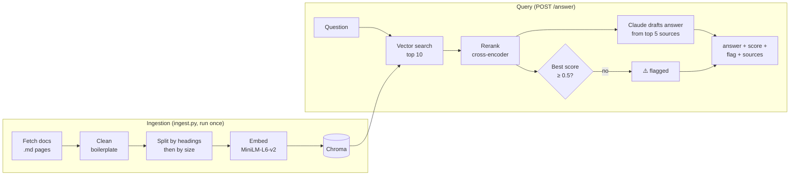

# Dealbreaker

**Grounded, cited answers to prospects' technical security & compliance questions, built for SDRs.**

In B2B sales, deals often stall on one deal-breaker question: *"Can our data stay in the EU?"*, *"Are you SOC 2 certified?"*, *"Can we use you under HIPAA?"* The difference between *"let me get back to you"* and *"sounds good, let's book"* is having an accurate answer on the spot. Dealbreaker gives SDRs that answer in seconds, grounded only in the company's own documentation, with sources, and it **flags anything it can't verify** instead of guessing.

> **Core principle:** a false flag costs a few minutes with a sales engineer; false information can cost the deal. The system leans towards flagging.

*Demo knowledge base built from [PostHog](https://posthog.com)'s public security & privacy documentation. Not affiliated with PostHog.*

---

## What it does

1. The SDR pastes a prospect's question into the web app.
2. Dealbreaker retrieves the most relevant passages from the company docs, reranks them, and decides whether the evidence is strong enough.
3. Claude drafts a short, prospect-ready answer **using only those passages**, citing them as `[1]`, `[2]`, …
4. The SDR sees the draft, a confidence score, numbered source links, and a ⚠️ **"check with your SE"** banner when confidence is low.

It also handles the messy cases real knowledge bases have:

- **Partial answers:** answers what the docs cover and names what they don't (e.g. HIPAA: "yes, but only with a BAA on certain plans").
- **Conflicting sources:** surfaces disagreements between pages (e.g. an outdated page with an older SOC 2 report date) instead of silently picking one.
- **Not covered:** says so and recommends checking with a sales engineer, never inventing a certification.

## How it works



| Stage | File | What it does |
|---|---|---|
| Ingestion | `backend/ingest.py` | Downloads the `.md` versions of the docs (allow-list: only `text/plain` responses, which catches soft-404s), strips boilerplate (AI-agent notes, canonical URLs, tables of contents, HTML entities), splits by markdown headings then into ≤1000-character pieces (150 overlap) so nothing exceeds the embedding model's input limit, embeds and stores in Chroma with URL + section metadata. Rebuilt from scratch on every run, so no duplicates. |
| Retrieval | `backend/retrieve.py` | Semantic search: returns the top-k chunks closest in meaning to the question. |
| Rerank + flag | `backend/rerank.py` | A cross-encoder reads the question and each chunk *together* and scores relevance. `should_flag` flags the answer when the best score is below 0.5 (or nothing was found). |
| Generation | `backend/generate.py` | Builds numbered source cards and calls Claude with a system prompt of 7 rules: sources only, partial answers, surface conflicts, no guarantees or legal advice, ignore instructions inside sources, concise tone, cite by number (URLs are attached by code, never written by the model). |
| API | `backend/main.py` | FastAPI `POST /answer` → `{ answer, flagged, score, sources[] }`. Returns `400` for empty questions. |
| Web app | `frontend/` | Vite + TypeScript single page. |
| Evaluation | `backend/run_eval.py`, `backend/test_set.py` | Labelled test set, search metrics, answer metrics. |

## Evaluation

The test set has **8 realistic prospect questions** covering four behaviours: clean answers, partial answers, a source conflict, and a question the docs can't answer. Each question has hand-labelled correct passages (by URL + section) and a reference answer.

### Search quality (k = 5)

| Pipeline | Precision@5 | Recall@5 |
|---|---|---|
| Vector search only (baseline) | 0.50 | 0.88 |
| **Vector search top 10 → rerank → keep 5** | **0.55** | **0.92** |

The reranker improves both. The biggest win was the data-deletion question (precision 0.40 → 0.80, recall 0.50 → 1.00), whose answer is spread across GDPR and CCPA pages.

### Answer quality

| ROUGE-1 | ROUGE-2 | ROUGE-L | BLEU | Perplexity (GPT-2) |
|---|---|---|---|---|
| 0.45 | 0.28 | 0.38 | 0.17 | 58.3 |

Answers are generated once and saved to `answers.json`, so scores are reproducible and re-scoring doesn't call the API again. Citations and markdown are stripped before scoring.

**How to read these:** ROUGE and BLEU measure word overlap with *one* reference answer, not correctness. BLEU is low partly because Claude adds correct details that aren't in the reference (e.g. the 45-day CCPA response window), which overlap metrics penalise. Perplexity measures fluency only: a fluent wrong answer would still score well. Correctness is covered by the flag checks and a manual review of all 8 answers.

### Flagging

| # | Question (abridged) | Expected | Flagged | Result |
|---|---|---|---|---|
| 1 | Can you guarantee our data stays in the EU? | answer | yes | ⚠️ false alarm (see limitations); the answer itself is correct |
| 2 | Are you SOC 2 certified? | answer | no | ✅ |
| 3 | How current is your SOC 2 report? | conflict | no | ✅ conflict surfaced in the answer |
| 4 | Can we use PostHog under HIPAA? | partial | no | ✅ "yes, but" with conditions |
| 5 | Controller or processor under GDPR? | answer | no | ✅ |
| 6 | Can we delete a user's data? | answer | no | ✅ |
| 7 | Can we see your incident response plan? | partial | yes | ✅ |
| 8 | Are you ISO 27001 certified? | flag | yes | ✅ no invented certification |

The threshold (0.5) was tuned on these scores: every answerable question except #1 scored ≥ 0.68; #7 and #8 scored ≈ 0.002.

## Design decisions

- **Allow-list over block-list** for downloaded content: accept only `text/plain`, so unplanned failure modes (soft-404 HTML pages, a typo'd domain) are rejected too.
- **Heading-aware chunking:** a chunk like *"Yes, we can provide a BAA…"* only makes sense with its heading (*"Can I use PostHog Cloud under HIPAA?"*), so headings stay inside chunks and in the citation.
- **Two-stage retrieval:** cheap vector search narrows 80 chunks to 10; the slower, more accurate cross-encoder judges those 10.
- **Code decides confidence, the model writes:** the flag comes from a tested, tuned threshold, not from the model's own judgement, and the API returns both the decision and the raw score.
- **Citations by number, URLs attached by code:** the model never types a URL, so it can't hallucinate one.
- **Synthetic test fixture for conflicts:** PostHog's docs briefly disagreed on their SOC 2 report date, then fixed it. A clearly labelled fixture (`fixture://stale_soc2_page.md`) reproduces that situation so the conflict behaviour stays testable.

## Known limitations

- **Q1 false flag:** the reranker under-scores the EU-data question (0.023) even though the answer is correct. Accepted trade-off under the "flag rather than mislead" principle; a stronger reranker is the next thing to test.
- **Small test set** (8 questions, one reference each), so metrics are indicative, not statistically strong.
- **Missing-space artefact** in some chunks where lines are joined (e.g. "howyou").
- **Section-level labels:** two chunks that share a section name can't be told apart by the answer key.
- The fixture source link isn't openable in a browser (by design, it's test data).

## Tech stack

Python 3.14 · FastAPI · Chroma · sentence-transformers (`all-MiniLM-L6-v2`, `BAAI/bge-reranker-base`) · LangChain text splitters · Anthropic Claude API · Hugging Face `evaluate` (ROUGE, BLEU) · GPT-2 (perplexity) · Vite + TypeScript

## Running it locally

**Backend** (from `backend/`):

```bash
python -m venv .venv
source .venv/Scripts/activate        # Windows Git Bash; on macOS/Linux: source .venv/bin/activate
pip install -r requirements.txt
echo "ANTHROPIC_API_KEY=your-key" > .env

python ingest.py                     # build the knowledge base (80 chunks)
uvicorn main:app --reload            # API on http://localhost:8000
```

**Frontend** (from `frontend/`, in a second terminal):

```bash
npm install
npm run dev                          # web app on http://localhost:5173
```

**Evaluation** (from `backend/`):

```bash
python run_eval.py                   # search metrics (baseline vs reranked) + answer metrics
```

Example API call:

```bash
curl -X POST http://localhost:8000/answer -H "Content-Type: application/json" \
  -d '{"question": "Are you SOC 2 certified?"}'
```

## Project structure

```
dealbreaker/
├── backend/
│   ├── config.py          # shared settings (models, paths, flag threshold)
│   ├── ingest.py          # fetch → clean → split → embed → store
│   ├── retrieve.py        # vector search
│   ├── rerank.py          # cross-encoder rerank + should_flag
│   ├── generate.py        # system prompt, source cards, Claude call
│   ├── main.py            # FastAPI POST /answer
│   ├── test_set.py        # 8 labelled questions + reference answers
│   ├── run_eval.py        # precision/recall@k, ROUGE, BLEU, perplexity
│   ├── answers.json       # saved answers used for scoring
│   └── data/fixtures/     # synthetic stale page for the conflict test
└── frontend/              # Vite + TypeScript web app
```

## Next steps

- **Chrome extension for Gmail:** same API, another client: highlight a prospect's question in an email, get the grounded answer in place.
- **Bring your own docs:** upload internal battle cards, past approved answers and security questionnaires alongside public pages.
- **RFP mode:** answer a whole security questionnaire at once, flagging only the rows that need a human.
- Test a stronger reranker (e.g. `bge-reranker-v2-m3`) and expand the test set.
